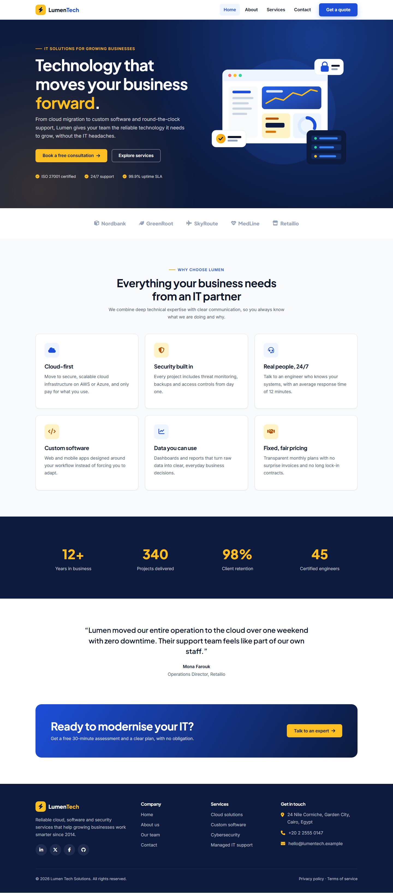

# Task 1 — Responsive Company Website

A fully responsive, four-page website for **Lumen Tech Solutions**, a fictional IT services company. It is built with semantic HTML5, a single organised CSS file and dependency-free ES6 JavaScript.

**Live demo:** https://guirguisnashat.github.io/Week2-Task-1/  
**Design decisions:** [docs/DESIGN.md](docs/DESIGN.md)

## Pages

| Page | Sections |
|------|----------|
| `index.html` (Home) | Hero with CTAs, client logos, 6 feature cards, stats band, testimonial, CTA banner |
| `about.html` | Company story, mission & 4 values, milestones timeline, **leadership team** (4 members) |
| `services.html` | 6 service cards, 4-step process, 3 pricing plans |
| `contact.html` | Contact cards, **validated contact form**, office map, FAQ accordion |

All four pages share the same header and footer. The footer holds company and service links, contact details and social icons.

## Features

- **Responsive navigation**: a hamburger menu below 900px. The icon animates into an ✕, the menu closes with <kbd>Esc</kbd> or when a link is clicked, background scrolling is locked while it is open, and it resets when the window is resized to desktop width.
- **Mobile-first layouts** built with CSS Grid and Flexbox, with breakpoints at **600px**, **900px** and **1200px**.
- **Contact form validation** in JavaScript:
  - required fields, name characters, email format, optional phone format, message length (20–500 characters) and a consent checkbox
  - inline error messages on blur and on submit, which clear as soon as the input is fixed
  - focus moves to the first invalid field, and a live character counter is shown
  - a success message appears and the form resets after a valid submit
- **Consistent branding** from CSS custom properties: one colour palette, two typefaces and a fixed spacing and radius scale.
- **Accessibility**:
  - skip link and visible `:focus-visible` outlines
  - `aria-expanded`, `aria-current`, `aria-invalid` and `aria-live` error messages
  - alt text on images and support for `prefers-reduced-motion`
- **Performance**: every image is a hand-written SVG (under 4 KB each), there is no framework, and only one CSS and one JS file are loaded.
- A back-to-top button appears after scrolling.

## Tech stack

| Area | Choice |
|------|--------|
| Markup | HTML5 (semantic elements) |
| Styling | CSS3: custom properties, Grid, Flexbox, media queries |
| Scripts | JavaScript ES6+ (no libraries) |
| Icons | Font Awesome 6 (CDN) |
| Fonts | Plus Jakarta Sans + Inter (Google Fonts) |
| Hosting | GitHub Pages |

## Folder structure

```
Task-1/
├── index.html
├── about.html
├── services.html
├── contact.html
├── css/
│   └── style.css         # tokens → base → components → sections → breakpoints
├── js/
│   └── main.js           # mobile nav, back-to-top, form validation, footer year
├── assets/images/        # SVG illustrations + favicon
├── docs/
│   └── DESIGN.md         # design decisions
└── screenshots/          # 4 pages × mobile / tablet / desktop
```

## Run locally

No build step is needed. Either open `index.html` directly in a browser, or serve the folder:

```bash
python -m http.server 8000
# open http://localhost:8000
```

## Testing performed

- Checked at 390px (mobile), 768px (tablet) and 1440px (desktop), with no horizontal scrolling on any page.
- Opened and closed the hamburger menu by click and by <kbd>Esc</kbd>, and checked that it resets when resized to desktop width.
- Contact form: an empty submit, invalid email/phone/message, and a valid submit followed by the success message and reset.
- No console errors.

## Screenshots

| | Mobile (390px) | Tablet (768px) | Desktop (1440px) |
|---|---|---|---|
| Home | [view](screenshots/home-mobile.png) | [view](screenshots/home-tablet.png) | [view](screenshots/home-desktop.png) |
| About | [view](screenshots/about-mobile.png) | [view](screenshots/about-tablet.png) | [view](screenshots/about-desktop.png) |
| Services | [view](screenshots/services-mobile.png) | [view](screenshots/services-tablet.png) | [view](screenshots/services-desktop.png) |
| Contact | [view](screenshots/contact-mobile.png) | [view](screenshots/contact-tablet.png) | [view](screenshots/contact-desktop.png) |



## Author

**Guirguis Nashat**, Full Stack Development Intern at WeIntern Pvt Ltd  
GitHub: [guirguisnashat](https://github.com/guirguisnashat) · Email: guirguisnashatzakisoliman@gmail.com
